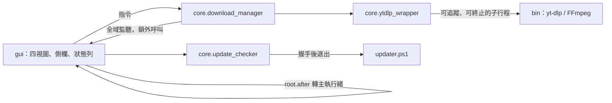

# 設計與計畫：EasyMusicDL「YT 暗黑工作台」改版

> 單一事實來源。每個里程碑合併後由 Claude 更新「狀態總覽」「追溯矩陣」「教訓清單」。
> 里程碑切分以本檔為準；色票、版面、後端行為與各階段細部驗收見 `docs/YT_STUDIO_DARK_REDESIGN_PLAN.md`（以下稱「來源文件」）。

| 項目 | 內容 |
| :-- | :-- |
| 版本 | v1.1（修訂歷史見文末） |
| 需求 | `docs/rgs/requirements.md` |
| 查證基準 | 基準 PR 合併後的 `main`；`F0` 沙盒實測紀錄；repo `bin/` 內 yt-dlp 2026.11.23 |

## 狀態總覽

| 里程碑 | 狀態 | 分支／PR | 測試數 | 備註 |
| :-- | :-- | :-- | :-- | :-- |
| M1 | 已合併 | `chore/m1-tests`／#3 | 101（預設 100，`network` 1） | 2 輪修正；合併閘門 PASS，無意見。PR 在閘門完成前已合併，內容與審查版本相同 |
| M2 | 未開始 | `fix/m2-cancel` | | |
| M3 | 未開始 | `fix/m3-updater` | | 含端對端驗收 |
| M4 | 未開始 | `feat/m4-theme` | | |
| M5 | 未開始 | `feat/m5-backend-media` | | |
| M6 | 未開始 | `feat/m6-backend-queue` | | |
| M7 | 未開始 | `feat/m7-shell` | | |
| M8 | 未開始 | `feat/m8-workbench` | | |
| M9 | 未開始 | `feat/m9-queue-view` | | |
| M10 | 未開始 | `feat/m10-library` | | |
| M11 | 未開始 | `feat/m11-settings` | | |

狀態只用：未開始、實作中、審查中、待合併、已合併、延後。

## 已查證事實

「靜態」表示只讀過程式碼，尚未以測試重現。

| 項目 | 結果 | 對實作的影響 |
| :-- | :-- | :-- |
| 測試現況 | M1 起有 pytest 測試；改版前沒有任何測試 | 之後的里程碑不得讓既有測試退化 |
| `gh` 預設 repo | 本機有指向原作者專案的 `upstream` remote，`gh` 未指定時操作該專案；`rgs.py ship` 因此嘗試在該處開 PR 而失敗，沒有建立任何東西 | 執行 `rgs` 腳本與 `gh` 時明確指定本專案 repo（D-10） |
| 停止全部下載（靜態） | `stop_all_downloads()` 持 `queue_lock` 時經 `_cancel_download()`、`get_download_item()` 再取同一把鎖 | 下載中關閉或 GUI 更新會卡死；M2 |
| 取消（靜態） | 只改狀態，不終止子行程；worker 可能改回完成或失敗 | M2 |
| `F0` 更新實測 | 重啟回報 `Access is denied` 後回滾，刪掉新版；備份已先刪除 | 重啟移出回滾範圍；M3 |
| updater 自動啟動 | 推測未執行、之後手動執行（未證實）；`DETACHED_PROCESS` 為成因只是假設 | M3 用握手與端對端確認 |
| 回滾（靜態） | 複製成功後才記錄項目；回滾錯誤被忽略仍記完成 | M3 |
| 更新腳本來源 | 由執行中的舊版產生 | M3 驗收要重新打包修正版的「舊版」 |
| 公開測試 Release `v2026.11.28` | 非 prerelease、為 Latest；含舊更新器 | M3 複測後經同意刪除，否則改標 prerelease |
| `add_download()`（靜態） | 強制 mp3；無標題時同步抓資訊 | M5、M6 |
| `_DEST_RE`（靜態） | 只收 `.mp3` | M5 改用 `--print-to-file`，保留備援 |
| 佇列行為（靜態） | 並發上限只在建構時讀；清除完成會連失敗一起刪且不存檔；建構時即自動下載 | M6 |
| `icons.py` | 色票按淺／深 tuple 解包 | M4 與 `theme.py` 同一變更 |
| 設定檔 | 第一次啟動寫入全部預設值 | 舊 `theme_mode` 直接忽略 |
| `build.py` | `clean_build()` 刪整個 `dist/` | M11 修正前只在 repo 外複本打包 |
| 舊元件 | 五個舊元件不在 `hiddenimports`；`format_detector.py` 只被 `download_options.py` 匯入 | M11 一併刪除 |
| `dist/EasyMusicDL.rar` 基準 SHA-256 | `aaa409907e75894d7a54a767dfa79e94e884fb34113135794d65aa7aecd3607a` | 每次打包類驗證後比對 |

## 決策紀錄

| 編號 | 決策 | 理由與替代方案 | 日期 |
| :-- | :-- | :-- | :-- |
| D-1 | 單一深色，移除淺色模式與主題切換 | 使用者決定；未採用「升級時切一次深色」與「沿用舊設定」 | 2026-11-28 |
| D-2 | M4A／OPUS 保留原始音軌，不標 160k | 使用者決定；避免多一次有損壓縮 | 2026-11-28 |
| D-3 | 主按鈕底改 `#E03131`、調亮 `text_muted`、新增 `danger_text` | 原色票未達 4.5:1 | 2026-11-28 |
| D-4 | 用 `rgs-pr`，一個里程碑一個 PR，使用者手動合併 | 使用者決定 | 2026-11-28 |
| D-5 | commit 訊息用英文，文件用繁體中文 | 延續既有歷史；使用者確認 | 2026-11-28 |
| D-6 | 原 F0.1 拆為 M2、M3；原 F2 拆為 M5、M6 | 單次變更太大時，不能執行程式的實作者容易出錯；M2 先做，因為更新的 GUI 路徑需要能停止下載 | 2026-11-28 |
| D-7 | 合併審查報告不貼 PR 留言，只寫入 `docs/rgs/reviews/` | 使用者決定 | 2026-11-28 |
| D-8 | 里程碑合併後，只含文件的更新（知識庫、本檔、審查紀錄）直接提交到 `main`；其他變更一律走 PR | 使用者決定，限本次改版 | 2026-11-28 |
| D-9 | G0 通過：核准需求 v1 與本設計 v1（11 個里程碑） | 使用者核准 | 2026-11-28 |
| D-10 | 執行 `rgs` 腳本時以環境變數 `GH_REPO` 指定本專案，`gh` 指令帶 `--repo` | 避免對原作者專案做任何操作；不改使用者的 git 設定 | 2026-11-28 |

## 架構

- 所有回呼在 `queue_lock` 之外呼叫；持鎖時只複製資料。
- 所有 yt-dlp 子行程（下載、解析、清單、取資訊）納入同一追蹤與退出順序。
- 背景 worker 用 daemon 執行緒與自有佇列，提供 `shutdown()`。

## 風險

| 風險 | 機率／影響 | 對策 |
| :-- | :-- | :-- |
| 防毒阻擋超過 5 次重試 | 中／中 | 保留新版與備份，提示手動開啟 |
| `DETACHED_PROCESS` 假設錯誤 | 中／高 | 握手避免主程式在更新腳本未啟動時退出；端對端失敗就回頭查根因 |
| OPUS 無法嵌入封面 | 未知／中 | M5 實測；失敗則停下來問使用者 |
| 介面在高 DPI 下截斷 | 中／中 | 視窗夾限、左欄可捲動、`ui_smoke` 與手動截圖 |
| 公開測試 Release 在刪除前被舊版更新到 | 低／高 | M2、M3 排在最前；複測後立即處理 |
| 範圍比原計畫大（暫存夾、縮圖載入器、退出順序） | 中／中 | 每個里程碑獨立可用；超出規格不做 |
| 審查修訂的最後版本未經複審 | 中／中 | 各里程碑仍經 Claude 審查與獨立合併閘門 |

## 里程碑

共通：每個 PR 合併後程式都能啟動使用；M1 起 `python -m pytest tests -q` 通過。「來源 F*」指來源文件的階段章節，其驗收條件屬於該里程碑的必要驗收。

### M1：測試安全網（來源 P0）
- 需求：R-1
- 相依：無
- 主要檔案：`tests/`（fixture 與基線測試）、`pyproject.toml`
- 測試：錯誤翻譯（至少 38 個錯誤字串）、日誌隱私、`UpdateChecker` 基線、最小 `network` marker 測試
- 驗證：預設 pytest 通過且顯示 1 deselected；`-m network` 顯示 1 passed（不需外網）；`git status` 乾淨

### M2：停止、取消與退出（來源 F0.1 第 1、4 項與「後端」的取消條目）
- 需求：R-2
- 相依：M1
- 主要檔案：`core/download_manager.py`、`core/ytdlp_wrapper.py`、`gui/main_window.py`、`gui/components/music_search_view.py`
- 測試：死結回歸、行程樹終止（假子行程）、取消競態、退出後不啟動新行程
- 驗證：pytest；手動在下載中關閉視窗，確認關閉且沒有殘留 yt-dlp／FFmpeg

### M3：自我更新器（來源 F0.1 第 2、3、5 項與端對端驗收）
- 需求：R-3
- 相依：M2
- 主要檔案：`core/update_checker.py`、`ytdlp_gui/main.py`、`gui/components/help_dialog.py`
- 測試：真實執行產生的 PowerShell 腳本的各失敗情境；握手逾時、舊標記、重複呼叫；日誌節流
- 驗證：pytest；用任務 worktree 的複本打包修正版舊版做端對端（含另一份沙盒的 GUI 路徑），通過後才請使用者合併；之後經同意處理 `v2026.11.28`

### M4：視覺地基（來源 F1）
- 需求：R-4
- 相依：M1
- 主要檔案：`gui/theme.py`、`gui/icons.py`、`core/settings_manager.py`、`gui/main_window.py`、`ytdlp_gui/main.py`、`gui/components/help_dialog.py`、`.interface-design/system.md`
- 測試：對比矩陣、色鍵存在、舊 `theme_mode` 忽略、新設定存讀
- 驗證：pytest；手動啟動確認全部深色、原功能可用

### M5：後端：輸入、格式與檔案（來源 F2 的分類、清單、批次過濾、格式、封面、暫存夾、最終路徑）
- 需求：R-5、R-6
- 相依：M2
- 主要檔案：`core/ytdlp_wrapper.py`、`core/download_manager.py`
- 範圍補充：`DownloadItem` 新欄位、`add_download()` 接受格式與封面、任務暫存夾與統一移除函式（涵蓋既有的清除與載入丟棄路徑）
- 測試：分類、批次過濾、格式×封面參數、清單截斷、封面重試、路徑讀回、暫存夾清理、舊佇列相容
- 驗證：pytest；`-m network` 整合（6 種下載、ffprobe、音軌 md5），失效樣本記為未驗證

### M6：後端：佇列管理與狀態（來源「後端」的批次、重試與移除、監聽、Cookie 燈號）
- 需求：R-7、R-8
- 相依：M5
- 主要檔案：`core/download_manager.py`、`core/cookie_manager.py`、`gui/main_window.py`、`gui/components/music_search_view.py`
- 測試：批次 2 worker 與 50 筆退出、重試／移除／清除／並發、鎖外回呼、`start()` 續傳、Cookie 狀態轉移
- 驗證：pytest；手動確認重啟後佇列續傳、現有畫面進度正常

### M7：主框架（來源 F3）
- 需求：R-9、R-8
- 相依：M4、M6
- 主要檔案：`gui/components/sidebar_nav.py`、`gui/components/status_bar.py`、`gui/main_window.py`、`tools/ui_smoke.py`
- 測試：視窗尺寸夾限純函式；`ui_smoke` 骨架
- 驗證：pytest；`python tools/ui_smoke.py`；來源 F3 的舊功能手動清單

### M8：解析工作台與即時佇列（來源 F4＋F5）
- 需求：R-9、R-5、R-7
- 相依：M7
- 主要檔案：`gui/components/parser_workbench_view.py`、可重用佇列卡與縮圖載入器模組、`gui/main_window.py`、`tools/ui_smoke.py`
- 測試：來源 F4＋F5 的自動驗收（假解析器與假下載管理器）
- 驗證：pytest；`ui_smoke`；手動確認完成項可在檔案總管定位

### M9：下載佇列頁（來源 F6）
- 需求：R-10、R-7
- 相依：M8
- 主要檔案：`gui/components/queue_view.py`、`gui/main_window.py`、`tools/ui_smoke.py`
- 測試：篩選計數、取消、重試、清除同步、`status_note` 顯示
- 驗證：pytest；`ui_smoke`

### M10：我的音樂（來源 F7）
- 需求：R-11
- 相依：M7
- 主要檔案：`gui/components/my_music_view.py`、`tools/ui_smoke.py`
- 測試：三種副檔名（含大寫）、搜尋、上限提示、底部列、異常情境
- 驗證：pytest；`ui_smoke`

### M11：設定頁與清理（來源 F8 與「最終驗證」）
- 需求：R-12、R-13、R-4
- 相依：M3、M9、M10
- 主要檔案：`gui/components/settings_view.py`、`build.py`、舊元件刪除、`README.md`、`pyproject.toml`、文案所在模組、`tools/ui_smoke.py`
- 測試：假 `UpdateChecker` 流程、兩項防護、`clean_build()`、`tests/test_source_rules.py`、`tests/test_imports.py`
- 驗證：來源文件「最終驗證」全部項目，含 100／125／150% 截圖與沙盒打包

## 追溯矩陣

| 需求 | 里程碑 | 測試 | PR |
| :-- | :-- | :-- | :-- |
| R-1 | M1 | 基線測試與 marker 邊界 | #3 |
| R-2 | M2 | 死結、取消、退出 | |
| R-3 | M3 | 更新腳本情境、端對端 | |
| R-4 | M4、M11 | 對比矩陣、`ui_smoke`、原始碼規則 | |
| R-5 | M5、M8 | 分類、清單、批次、工作台 | |
| R-6 | M5 | 參數、暫存夾、network 整合 | |
| R-7 | M6、M8、M9 | 佇列操作與介面 | |
| R-8 | M6、M7 | Cookie 狀態轉移、燈號跳轉 | |
| R-9 | M7、M8 | `ui_smoke`、工作台驗收 | |
| R-10 | M9 | 佇列頁 | |
| R-11 | M10 | 我的音樂 | |
| R-12 | M11 | 設定頁 | |
| R-13 | M11 | `clean_build()`、匯入、原始碼規則、沙盒打包 | |

## 教訓清單

<!-- 審查中反覆出現的錯誤，寫進之後每份 spec 的「先前的教訓」。初版取自改版前的查證。 -->

1. 持有 `queue_lock` 時不可呼叫會再取鎖的方法或任何回呼（出處：改版前查證）。
2. 測試不得寫入 repo 內的 `data/`、`logs/`，建構 `DownloadManager` 前要隔離，否則可能開始真實下載（出處：改版前查證）。
3. 回滾範圍不得包含重啟新版（出處：`F0` 實測）。
4. 修改色票時 `theme.py` 與 `icons.py` 要一起改（出處：改版前查證）。
5. 否定斷言（例如「日誌不含機密」）要同時斷言前提成立（假資料確實被讀到），否則可能空過（出處：PR #3）。
6. 保存函式參考供 `is` 比對時用 `types.SimpleNamespace`，不要用類別屬性（出處：PR #3）。
7. 新增檔案後確認沒有被 `.gitignore` 忽略；檔名以 `test_`、`debug_` 開頭或副檔名為影音格式者特別注意（出處：PR #3）。
8. 修改的檔案結尾不得有空白行，局部編輯刪不掉時整檔覆寫（出處：PR #3）。

## 修訂歷史

| 版本 | 日期 | 變更 |
| :-- | :-- | :-- |
| v1 | 2026-11-28 | 初版；里程碑由來源文件的 M1–M9 調整為 M1–M11（D-6） |
| v1.1 | 2026-11-28 | M1 已合併：狀態、追溯、教訓；記錄 `gh` 預設 repo 問題（D-10） |
